# Model architecture diagrams

This document maps every distinct learned architecture used by the repository.
Experiment names that only change a loss, training schedule, or inference mode
share a diagram. The six classical interpolation/filtering baselines are not
neural models and therefore do not have layer diagrams.

All tensor shapes use `B x C x H x W`. Except for the RGB hybrid, learned models
receive normalized, full-resolution `[Y, Cr, Cb]`; `Cr` and `Cb` have already
been downsampled to 4:2:0 and reconstructed to `H x W` by the configured
interpolator.

For conference posters and slide decks, use the large-type vector exports in
[`docs/figures/model-architectures`](figures/model-architectures/README.md). The
SVG files are best for PowerPoint/Keynote and the PDFs are best for print or
LaTeX workflows.

## Architecture index

| Architecture | Repository models and experiments | Default trainable parameters | Implementation |
| --- | --- | ---: | --- |
| V5 U-Net generator | `v5`, V5.1, `v5_unet_gan`, `v5_prism_mse` | 1,925,667 | [`UNetGenerator`](../chroma/models.py) |
| V5 PatchGAN discriminator | V5 and V5.1 adversarial training | 694,241 | [`Discriminator`](../chroma/models.py) |
| V6 residual refiner | `v6`, `v6_residual` | 593,794 | [`ChromaRefiner`](../chroma/models.py) |
| Configurable residual refiner | `base_v6_retrained`, `no_luma`, `direct_chroma`, `no_block_skips`, depth/width/loss ablations | 593,794 at the base settings | [`AblationChromaRefiner`](../chroma/research_models.py) |
| Chroma SRCNN | `srcnn_chroma` | 19,298 at width 64 | [`SrcnnChromaRefiner`](../chroma/research_models.py) |
| NAF-style refiner | `naf_style_chroma`, `prism_naf` | 249,218 at width 64 and depth 8 | [`NAFStyleChromaRefiner`](../chroma/research_models.py) |
| V7 polar probabilistic refiner | all `v7_*` experiments and mean/safe inference | 595,525 | [`V7PolarChromaRefiner`](../chroma/v7.py) |
| Prism configurable refiner | all `prism_*` experiments | 249,218–1,938,178 in checked-in production configurations | [`PrismRefiner`](../chroma/prism_models.py) |
| Prism conditional discriminator | `prism_gan` training only | 94,977 | [`PrismDiscriminator`](../chroma/prism_models.py) |
| Li2026 neural hybrid | `v6_*` and `prism_residual_*` hybrid runs | selected backbone plus one scalar gain | [`HybridRefiner`](../chroma/li2026_hybrid.py) |
| Hosted TabPFN adapter | per-image `TabPFNRegressor` pilot | hosted model; not inspectable here | [`reconstruct`](../chroma/tabpfn.py) |

`prism_mse`, `prism_edge`, and `prism_forward` use the same Prism residual
architecture as `prism_residual`. Likewise, `prism_polar_forward` shares the
`prism_polar_prob` architecture. Loss edges are shown only where they alter the
trainable graph, as in the adversarial discriminators.

## Shared observation pipeline

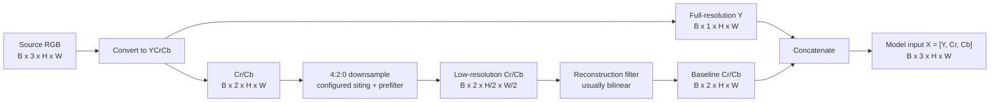

## V5 U-Net generator and PatchGAN

V5 regenerates all three channels. Its encoder has three pooling operations, so
inputs are padded to a multiple of eight for inference. V5.1 uses exactly the
same architecture. The matched `v5_prism_mse` run wraps the generator with an
observed-luma passthrough and does not use the discriminator.

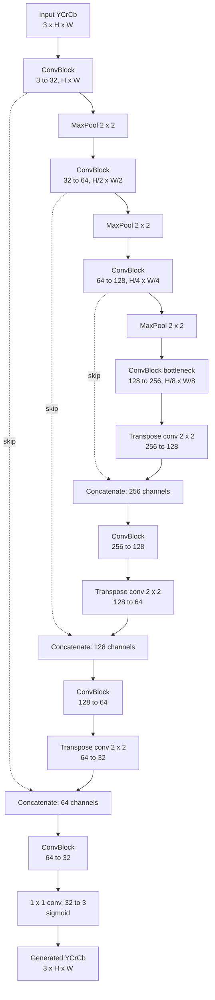

Each `ConvBlock` is `3 x 3 convolution -> ReLU -> 3 x 3 convolution -> ReLU`.

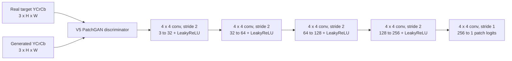

## V6 residual chroma refiner

V6 predicts only a two-channel correction. The original luminance bypasses the
network unchanged.

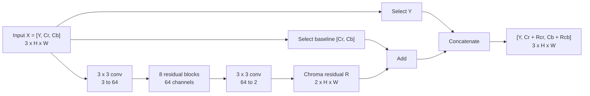

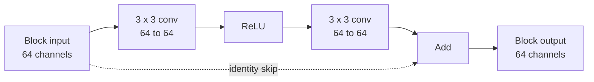

## Configurable residual ablation family

The research ablation model generalizes V6 with explicit switches. Loss-only
experiments do not alter this forward graph.

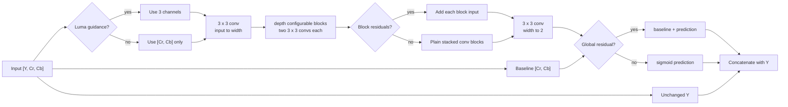

Checked-in variants change `depth` (4/8/12), `width` (32/64/96), luma input,
per-block skips, or global residual prediction. `loss_mse`, `loss_charbonnier`,
and `loss_l1_edge` keep the base forward graph.

## Chroma SRCNN

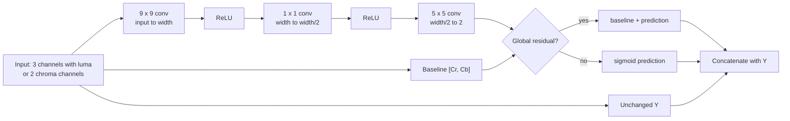

## NAF-style chroma refiner

The outer refiner uses the same chroma-residual contract as V6, but replaces
ReLU residual blocks with nonlinear-activation-free restoration blocks.

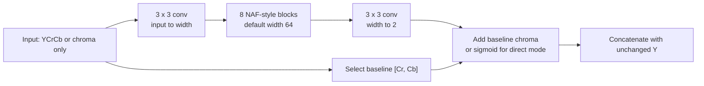

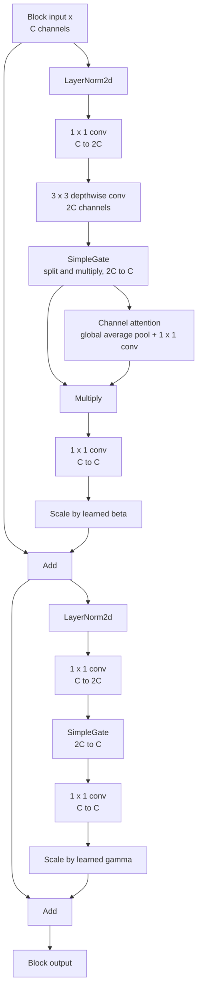

## V7 probabilistic polar refiner

V7 keeps V6's stem and eight-block trunk, but the five-map head predicts a polar
mean correction and two uncertainty parameters. `mean` and `safe` are two
post-processing paths from the same trained architecture.

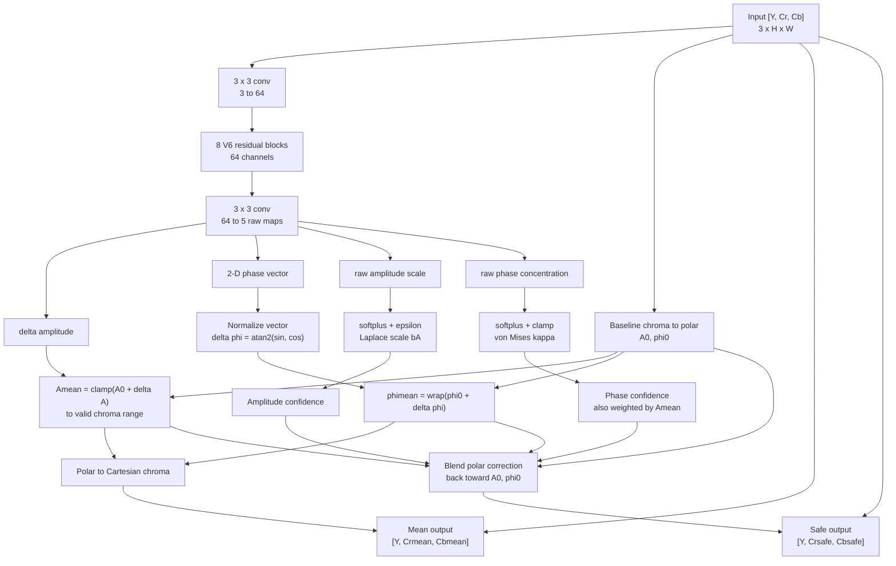

The deterministic, probabilistic, forward-consistency, safe-inference, and
self-training V7 experiments all instantiate this same five-map network. Their
loss terms, data stage, or selected output differ.

## Prism configurable family

Prism combines three backbone choices, two output representations, optional
known-degradation conditioning, and optional uncertainty heads in one model.

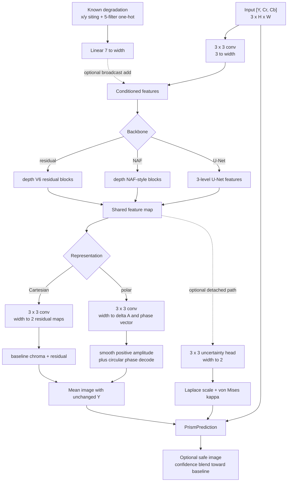

### Prism U-Net backbone

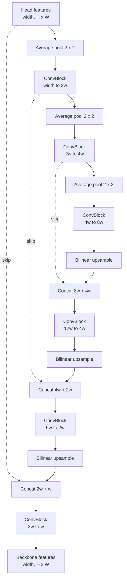

### Prism conditional PatchGAN

Only `prism_gan` creates this discriminator. It judges target or generated
chroma while conditioning on the complete observed input.

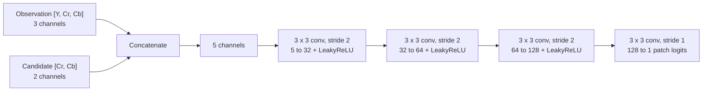

## Li2026 neural hybrid

The hybrid first constructs an RGB baseline with the audited Li et al.-inspired
analytic pipeline, then lets a frozen-checkpoint-initialized V6 or Prism model
propose a chroma-only correction. A learned scalar gain starts at zero. Retained
sample sites, and optionally locally flat-chromaticity regions, are protected.

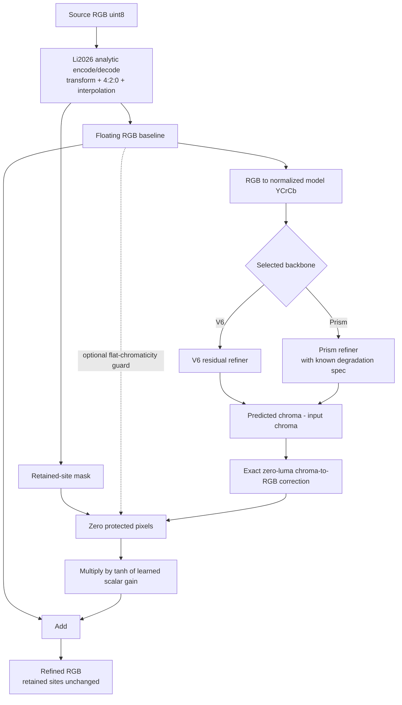

## Hosted TabPFN per-image regressors

The repository owns the feature and reconstruction pipeline, but the selected
hosted `TabPFNRegressor` is an external black box. The diagram deliberately does
not claim internal layers that the repository cannot inspect.

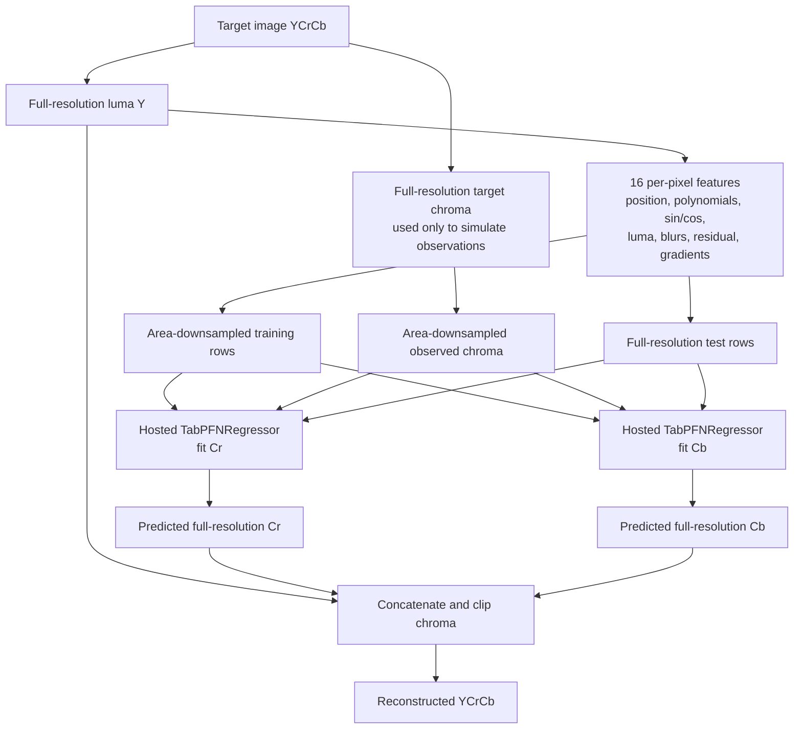

## Experiment-to-diagram map

| Experiment group | Forward architecture above |
| --- | --- |
| V5, V5.1, `v5_unet_gan` | V5 U-Net generator; adversarial runs also use V5 PatchGAN |
| `v5_prism_mse` | V5 U-Net generator followed by observed-Y passthrough |
| V6, `v6_residual` | V6 residual chroma refiner |
| `base_v6`, `base_v6_retrained`, `no_luma`, `direct_chroma`, `no_block_skips`, `depth_4`, `depth_12`, `width_32`, `width_96`, `loss_mse`, `loss_charbonnier`, `loss_l1_edge`, `v6_cartesian_deterministic` | Configurable residual ablation family |
| `srcnn_chroma` | Chroma SRCNN |
| `naf_style_chroma` | NAF-style chroma refiner |
| `v7_polar_deterministic`, `v7_probabilistic`, `v7_probabilistic_forward`, `v7_probabilistic_safe`, `v7_self_train` | V7 probabilistic polar refiner |
| `prism_residual`, `prism_mse`, `prism_edge`, `prism_forward` | Prism with residual backbone and Cartesian head |
| `prism_naf` | Prism with NAF backbone and Cartesian head |
| `prism_polar` | Prism with residual backbone and deterministic polar head |
| `prism_polar_prob`, `prism_polar_forward` | Prism with residual backbone, polar head, and uncertainty head |
| `prism_cartesian_prob` | Prism with residual backbone, Cartesian head, and detached uncertainty head |
| `prism_conditioned` | Conditioned Prism with residual backbone and Cartesian head |
| `prism_unet`, `prism_unet_mse` | Prism U-Net with Cartesian head |
| `prism_gan` | Prism U-Net plus conditional Prism PatchGAN during training |
| Li2026 hybrid runs | Li2026 neural hybrid with the named V6 or Prism backbone |
| TabPFN pilot | Hosted TabPFN per-image regressor pipeline |
